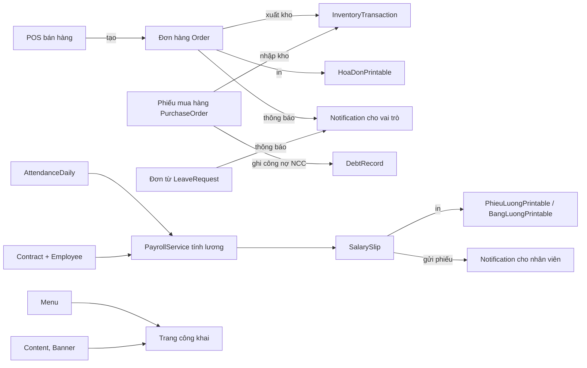

# ERP_HRM_CMS — Quản lý nhân sự, bán hàng & kho, CMS

Ứng dụng ASP.NET Core MVC (.NET 8) + Entity Framework Core + SQL Server. Gồm các phân hệ: Nhân sự (HRM, chấm công, đơn từ, bảng lương), Bán hàng POS và đơn hàng, Kho (nhập/xuất/điều chuyển/kiểm kê), Mua hàng và công nợ (SCM), CMS và trang công khai, thông báo thời gian thực (SignalR), nhật ký kiểm toán (AuditLog).

## 1. Yêu cầu

- .NET 8 SDK
- SQL Server (hoặc LocalDB) có quyền tạo database
- Visual Studio 2022 phiên bản 17.14 trở lên (hoặc `dotnet` CLI)

## 2. Cấu hình

Chuỗi kết nối mặc định nằm trong `appsettings.json` (`ConnectionStrings:DefaultConnection`, dùng Windows Authentication).

Không đặt mật khẩu trong file cấu hình. Nếu cần SQL Authentication hoặc mật khẩu admin khởi tạo, dùng User Secrets:

```
dotnet user-secrets init
dotnet user-secrets set "SeedAdmin:Password" "<mật khẩu admin mạnh>"
dotnet user-secrets set "ConnectionStrings:DefaultConnection" "<chuỗi kết nối>"
```

Nếu để trống `SeedAdmin:Password`, khi tạo database lần đầu hệ thống sinh mật khẩu ngẫu nhiên cho tài khoản `admin` và in ra console. Hãy đổi mật khẩu ngay sau lần đăng nhập đầu tiên.

## 3. Tạo database

Cách 1 (khuyến nghị cho dự án mới): chạy ứng dụng một lần. `DbInitializer` tự tạo bảng và seed dữ liệu mẫu.

Cách 2 (chạy script tạo schema thủ công): mở `SQLQuery1.sql` trong SSMS và chạy. Script này tạo `ERP_HRM_CMS_DB` và toàn bộ bảng, kèm tài khoản mẫu.

Lưu ý khi dùng script SQL:
- Script `SQLQuery1.sql` có tài khoản mẫu với mật khẩu `123456`. Chỉ dùng cho môi trường phát triển.
- Với database đã có từ trước, chạy `SQL_fix_users_employeeid_unique.sql` để sửa ràng buộc `EmployeeId` (cho phép nhiều tài khoản chưa gắn nhân viên). Script chạy trong transaction và an toàn khi chạy lại.
- `fix-placeholder-images.sql` đổi ảnh placeholder của dữ liệu seed sang file SVG cục bộ. Không cần chạy trên database mới.

## 4. Chạy ứng dụng

Mở `ERP_HRM_CMS.sln`, chọn profile `http` (cổng 5129) hoặc `https` (cổng 7184) rồi nhấn F5. Hoặc dùng CLI:

```
dotnet run --project ERP_HRM_CMS.csproj --launch-profile http
```

Trang đăng nhập: `/Auth/Login`. Các tài khoản mẫu trong `SQLQuery1.sql` có mật khẩu `123456` (chỉ môi trường phát triển).

## 5. Chạy kiểm thử

Project test nằm trong `tests/ERP_HRM_CMS.Tests` (xUnit, Microsoft.AspNetCore.Mvc.Testing).

```
dotnet test tests/ERP_HRM_CMS.Tests
```

Hoặc dùng Test Explorer trong Visual Studio.

Yêu cầu: SQL Server đang chạy trên `localhost` với Windows Authentication. Test dùng database riêng `ERP_HRM_CMS_TEST`, được tạo và seed tự động ở lần chạy đầu. Database phát triển không bị ảnh hưởng.

Các nhóm test hiện có:
- Đăng nhập: đúng mật khẩu, sai mật khẩu, tài khoản chưa duyệt, khóa sau 5 lần sai.
- Thông báo: thông báo cá nhân không lộ sang người khác, không đánh dấu đã đọc thông báo của người khác, trạng thái đã đọc của thông báo vai trò là riêng cho từng người.
- Bảo mật: Dashboard và SignalR Hub yêu cầu đăng nhập; chính sách mật khẩu.

## 6. Bảo mật

- Tài khoản mẫu và mật khẩu `123456` chỉ dùng trong phát triển. Trước khi đưa lên môi trường thật, xóa hoặc đổi mật khẩu các tài khoản này.
- Đăng nhập sai 5 lần liên tiếp với cùng tên đăng nhập sẽ bị khóa 15 phút. Bộ đếm lưu trong bộ nhớ, nên reset khi khởi động lại ứng dụng.
- Cookie xác thực và session bật `Secure` khi chạy production (HTTPS). Môi trường Development dùng `SameAsRequest` để chạy được HTTP.
- Nếu từng đưa mật khẩu SQL vào file cấu hình hoặc Git, hãy đổi mật khẩu đó trên SQL Server.

## 7. Cấu trúc thư mục chính

| Thư mục | Nội dung |
|---|---|
| `Controllers/`, `Views/` | MVC: controller và view theo từng phân hệ |
| `Models/Entities/`, `Models/ViewModels/` | Thực thể EF và view model |
| `Data/` | `AppDbContext` (model, audit log) và `DbInitializer` (schema và seed) |
| `Services/` | Giỏ hàng, thông báo, bảng lương |
| `Hubs/` | SignalR `NotificationHub` (`/hub/notifications`) |
| `Helpers/`, `Filters/` | Băm mật khẩu, phân quyền (`[KiemTraQuyen]`) |
| `wwwroot/` | CSS, JS, ảnh và thư viện front-end |
| `tests/` | Project kiểm thử xUnit |
| `scripts/legacy/` | Script PowerShell kiểm thử thủ công cũ (đã thay bằng project test) |

Các file `.sql` ở thư mục gốc là script vận hành, không được ứng dụng dùng khi chạy.

---

## Phân quyền và tài khoản quản trị

### Quản trị tổng

- `admin`: tài khoản quản trị ban đầu (`IsSuperAdmin = true`), tạo khi database trống.
- `quantritong`: tài khoản quản trị tổng thứ hai, có vai trò `SUPERADMIN` và toàn quyền. Có thể sửa khung hệ thống (layout, menu, cấu hình) và tạo các admin nhóm ở mục **Quản trị tài khoản**.
- Mật khẩu lấy từ `SeedAdmin:Password` (xem User Secrets ở trên). Nếu chưa cấu hình, mật khẩu ngẫu nhiên được in ra cửa sổ Output của Visual Studio **một lần duy nhất** khi tạo tài khoản. Tài khoản đã tồn tại thì không bị ghi đè mật khẩu.

### Admin nhóm (vai trò theo nhóm chức năng)

| Vai trò | Quyền được gán (theo tiền tố mã quyền) |
|---|---|
| `ADMIN_SANPHAM` Quản lý sản phẩm | `product.*`, `inventory.view` |
| `ADMIN_DONHANG` Quản lý đơn hàng | `order.*`, `debt.view`, `report.sales` |
| `ADMIN_NHANVIEN` Quản lý nhân viên | `hrm.employee.*`, `hrm.attendance.*`, `hrm.leave.*` |
| `ADMIN_BANGLUONG` Quản lý lương | `hrm.payroll.*`, `hrm.employee.view` |
| `ADMIN_KHO` Quản lý kho & mua hàng | `inventory.*`, `scm.*` |
| `ADMIN_MENU` Quản trị Menu website | `menu.*`, `product.view` |
| `ADMIN_CONTENT` Quản trị Nội dung | `content.*`, `layout.manage` |

Cách tạo admin nhóm: đăng nhập bằng `quantritong` → **Quản trị tài khoản** → tạo tài khoản mới và chọn một hoặc nhiều vai trò ở trên.

Quyền được kiểm tra bằng thuộc tính `[KiemTraQuyen("mã-quyền")]` trên từng action (xem `Filters/KiemTraQuyenAttribute.cs`).

---

## Luồng dữ liệu



Ghi chú: các luồng trên đối chiếu trực tiếp với code (`BanHangController`, `PurchaseOrderController`, `DonTuController`, `PayrollService`, `PublicController`).

---

## Lập trình hướng đối tượng: bản đồ trong code

Các chỗ được đánh dấu bằng chú thích `[OOP - ...]` trong code.

| Khái niệm | Vị trí | Ý nghĩa |
|---|---|---|
| Đóng gói | `Services/Printing/PrintableDocument.cs` | `_tieuDe`, `_thoiDiemIn` là `private`; mã hóa HTML và định dạng tiền nằm trong lớp cơ sở |
| Đóng gói | `Services/Printing/BangLuongPrintable.cs` (`TongThucLinh`) | Tổng tiền chỉ được tính từ danh sách phiếu, không gán từ bên ngoài |
| Đóng gói | `Models/Entities/InventoryEntities.cs` (`OrderDetail.TotalPrice`) | `private set`, chỉ đọc từ bên ngoài |
| Đóng gói | `Services/Printing/TrangIn.cs` | Khung trang và CSS in gói ở một nơi |
| Kế thừa | `PrintableDocument` → `PhieuLuongPrintable`, `BangLuongPrintable`, `HoaDonPrintable` | Lớp con không viết lại đầu trang, cách mã hóa, định dạng tiền |
| Kế thừa | `PhieuInController : Controller` | Dùng lại toàn bộ cơ chế controller của ASP.NET Core |
| Đa hình (abstract) | `PrintableDocument.NoiDungChinh()` | Mỗi loại phiếu tự quyết định nội dung chính |
| Đa hình (override) | `PhieuLuongPrintable.RenderFooter()`, `BangLuongPrintable.RenderHeader()` | Ghi đè đầu/chân trang, `RenderFooter` vẫn gọi `base` |
| Đa hình (interface) | `IPrintable`, `IPrintService` | `PrintService.RenderBatch` in lẫn nhiều loại phiếu trong một trang |
| Đa hình (DI) | `Program.cs`: `AddScoped<IPrintService, PrintService>()` | Nơi dùng chỉ phụ thuộc vào interface |
| Template Method | `PrintableDocument.RenderBody()` | Thứ tự đầu trang → nội dung → chân trang được cố định |
| Đa hình có sẵn | `IPayrollService`, `INotificationService`, `ICartService` | Đổi cách triển khai không cần sửa nơi gọi |

Các test cho những khái niệm này nằm trong `tests/ERP_HRM_CMS.Tests/PrintingTests.cs`.

## In ấn

| Phiếu | Đường dẫn | Quyền |
|---|---|---|
| Phiếu lương một nhân viên | `/PhieuIn/PhieuLuong/{id}` | `hrm.payroll.view` |
| Bảng lương cả kỳ (có lọc phòng ban) | `/PhieuIn/BangLuong?periodId={id}&departmentId={id}` | `hrm.payroll.view` |
| Cả kỳ lương: bảng tổng hợp + từng phiếu | `/PhieuIn/InKyLuongDayDu?periodId={id}` | `hrm.payroll.view` |
| Hóa đơn bán hàng | `/PhieuIn/HoaDon/{id}` | `order.view` |
