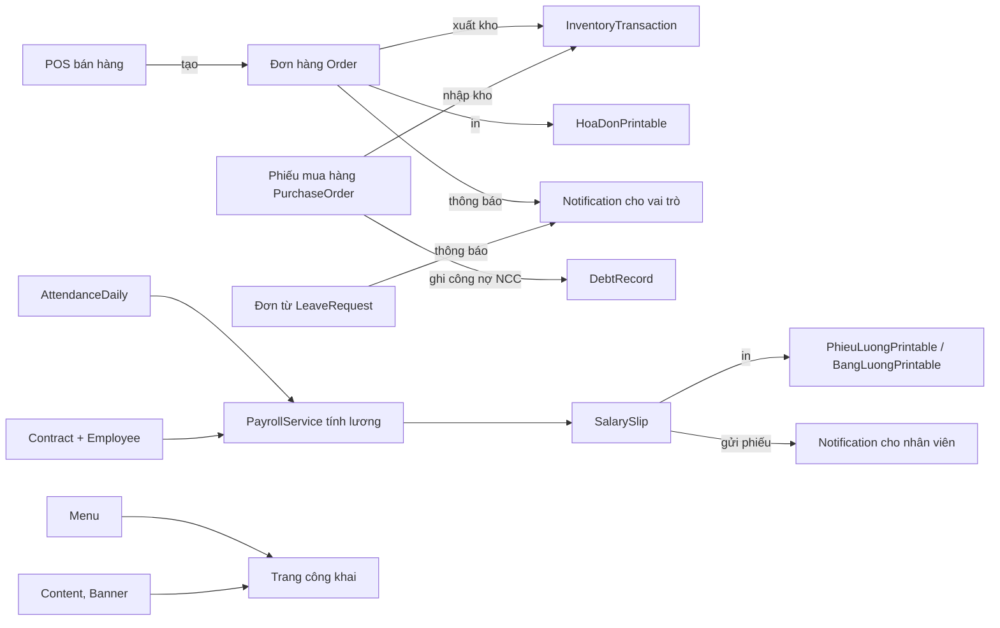

# ERP_HRM_CMS — Quản lý nhân sự, bán hàng & kho, CMS

Ứng dụng ASP.NET Core MVC (.NET 8) + Entity Framework Core + SQL Server. Gồm các phân hệ: Nhân sự (HRM, chấm công, đơn từ, bảng lương), Bán hàng POS và đơn hàng, Kho (nhập/xuất/điều chuyển/kiểm kê), Mua hàng và công nợ (SCM), CMS và trang công khai, thông báo thời gian thực (SignalR), nhật ký kiểm toán (AuditLog).

## 1. Yêu cầu

- .NET 8 SDK
- SQL Server (hoặc LocalDB) có quyền tạo database
- Visual Studio 2022 phiên bản 17.14 trở lên (hoặc `dotnet` CLI)

## 2. Cấu hình

Cấu hình đọc từ `appsettings.json`, rồi `appsettings.{Environment}.json`, User Secrets (chỉ Development) và biến môi trường. Không commit mật khẩu, chuỗi kết nối có bí mật hay khóa mã hóa.

**Development**

- Chuỗi kết nối cục bộ (Windows Authentication, không có mật khẩu) và `Seed:Demo = true` nằm trong `appsettings.Development.json`.
- Đặt mật khẩu quản trị ban đầu bằng User Secrets:

```
dotnet user-secrets init
dotnet user-secrets set "SeedAdmin:Password" "<mật khẩu admin mạnh>"
```

**Môi trường khác (Production, Staging)**: đặt biến môi trường, không đặt trong file cấu hình.

| Biến | Bắt buộc | Ý nghĩa |
|---|---|---|
| `ConnectionStrings__DefaultConnection` | Có | Chuỗi kết nối SQL Server |
| `SeedAdmin__Password` | Có khi tạo database lần đầu | Mật khẩu ban đầu của `admin` và `quantritong` |
| `DataProtection__KeysPath` | Có | Thư mục lưu khóa mã hóa (CCCD, số tài khoản). Phải lưu bền và có sao lưu. **Mất khóa này là không đọc lại được dữ liệu đã mã hóa.** |

Ứng dụng không khởi động nếu thiếu `ConnectionStrings:DefaultConnection` hoặc `DataProtection:KeysPath` (ngoài Development). Nếu database chưa có tài khoản quản trị và thiếu `SeedAdmin:Password`, ứng dụng dừng với thông báo cấu hình. Hệ thống không sinh mật khẩu ngẫu nhiên và không in mật khẩu ra console.

## 3. Tạo database

Cách 1 (khuyến nghị cho dự án mới): chạy ứng dụng một lần. `DbInitializer` tự tạo bảng, quyền, tài khoản quản trị và cấu hình site (SeedCore). Dữ liệu mẫu (SeedDemo) chỉ được tạo khi Development và `Seed:Demo=true`. Ở production, sau khi khởi động, cần tự tạo chi nhánh, phòng ban, chức vụ, nhân viên và sản phẩm.

Cách 2 (chạy script tạo schema thủ công): mở `Database/SQLQuery1.sql` trong SSMS và chạy. Script này tạo `ERP_HRM_CMS_DB` và toàn bộ bảng, kèm tài khoản mẫu.

Lưu ý khi dùng script SQL:
- Script `Database/SQLQuery1.sql` có tài khoản mẫu với mật khẩu `123456`. Chỉ dùng cho môi trường phát triển.
- Với database đã có từ trước, chạy `Database/SQL_fix_users_employeeid_unique.sql` để sửa ràng buộc `EmployeeId` (cho phép nhiều tài khoản chưa gắn nhân viên). Script chạy trong transaction và an toàn khi chạy lại.
- `Database/fix-placeholder-images.sql` đổi ảnh placeholder của dữ liệu seed sang file SVG cục bộ. Không cần chạy trên database mới.

### Lược đồ và migration (Giai đoạn 2)

- Ứng dụng dùng **EF Core Migrations** (`MigrateAsync`) thay cho `EnsureCreated`. Khi khởi động, `DbInitializer.MigrateSchemaAsync` áp dụng các migration còn thiếu.
- Migration baseline tạo bằng lệnh `dotnet ef migrations add InitialBaseline` (chạy tại thư mục dự án). Tên phải kết thúc bằng `_InitialBaseline`. Lệnh dùng `Data/AppDbContextFactory.cs` nên không chạy ứng dụng và không cần dữ liệu thật; có thể đặt `ConnectionStrings__DefaultConnection` nếu muốn. Nếu thiếu baseline, ứng dụng dừng với thông báo rõ ràng.
- Database đã có dữ liệu: khi khởi động lần đầu, ứng dụng đánh dấu baseline là đã áp dụng (không tạo lại bảng, không xóa dữ liệu).
- `Database/legacy-schema-fixes.sql` là các khối SQL cũ (chạy lại an toàn), tạo bảng `LoginAttempts`, `NotificationReads` và nới cột nhạy cảm. Với database cũ thiếu các bảng/cột này, chạy script trước khi khởi động ứng dụng.

### Thứ tự nâng cấp database đang có dữ liệu

Chỉ áp dụng cho database đã dùng trước giai đoạn này. Database mới không cần bước 2 và 3. Sao lưu trước; thử trên `ERP_HRM_CMS_DEV` trước khi chạy trên database thật.

1. Chạy `Database/legacy-schema-fixes.sql` (nếu thiếu bảng/cột như mô tả ở trên).
2. Chạy `Database/shift-instants-to-utc.sql` **một lần**, cùng lúc triển khai bản có `VietnamTimeConverter`. Script trừ 7 giờ cho 40 cột thời điểm (ví dụ `CreatedAt`) vì dữ liệu cũ là giờ Việt Nam. Script ghi nhật ký vào `dbo.__DataMigrationLog` nên chạy lại sẽ không trừ thêm.
3. Chạy `Database/migrate-role-aliases.sql` (bỏ vai trò alias, xem bảng vai trò bên dưới). Script chạy trong một transaction và an toàn khi chạy lại.
4. Khởi động ứng dụng.

### Thời gian

- Database lưu thời điểm theo **UTC**. Ứng dụng làm việc theo giờ **Asia/Ho_Chi_Minh** qua `VietnamTime` (`Helpers/VietnamTime.cs`). Converter `VietnamTimeConverter` đổi giờ khi ghi và đọc.
- Không dùng `DateTime.Now`/`DateTime.Today` trong mã nguồn (phụ thuộc múi giờ của máy chủ). Dùng `VietnamTime.Now`/`VietnamTime.Today`.
- Cột ngày lịch (`FromDate`, `ToDate`, `WorkDate`, `DueDate`, `HireDate`, `OrderDate`...) không đổi múi giờ. Cột kết thúc bằng `Utc` (ví dụ `LockedUntilUtc`) đã là UTC sẵn.
- Truy vấn SQL không dùng `.Date`/`.Month`/`.Year` trên cột thời điểm; dùng điều kiện khoảng thời gian.

## 4. Chạy ứng dụng

Mở `ERP_HRM_CMS.sln`, chọn profile `http` (cổng 5129) hoặc `https` (cổng 7184) rồi nhấn F5. Hoặc dùng CLI:

```
dotnet run --project ERP_HRM_CMS.csproj --launch-profile http
```

Trang đăng nhập: `/Auth/Login`. Các tài khoản mẫu trong `Database/SQLQuery1.sql` có mật khẩu `123456` (chỉ môi trường phát triển).

## 5. Chạy kiểm thử

Project test nằm trong `tests/ERP_HRM_CMS.Tests` (xUnit, Microsoft.AspNetCore.Mvc.Testing).

```
dotnet test tests/ERP_HRM_CMS.Tests
```

Hoặc dùng Test Explorer trong Visual Studio.

Yêu cầu: SQL Server đang chạy trên `localhost` với Windows Authentication. Test dùng database riêng `ERP_HRM_CMS_TEST`, được tạo và seed tự động ở lần chạy đầu. Database phát triển không bị ảnh hưởng.

Các nhóm test hiện có:
- Đăng nhập: đúng mật khẩu, sai mật khẩu, tài khoản chưa duyệt, khóa sau 5 lần sai.
- Thông báo: thông báo cá nhân không lộ sang người khác, không đánh dấu đã đọc thông báo của người khác, trạng thái đã đọc của thông báo vai trò là riêng cho từng người.
- Bảo mật: mọi endpoint yêu cầu đăng nhập trừ khi đánh dấu `[AllowAnonymous]` (kiểm tra bằng `AuthorizationDefaultTests`); Dashboard và SignalR Hub; chính sách mật khẩu.
- Khóa đăng nhập: 5 lần sai liên tiếp với cùng cặp (tên đăng nhập, IP) sẽ khóa 1 phút, sau đó thời gian khóa tăng gấp đôi tối đa 30 phút (`LoginThrottleTests`).
- Seed: quyền, tài khoản quản trị và cấu hình site; kiểm tra thiếu `SeedAdmin:Password` (`SeedGuardTests`).
- Mã hóa CCCD và số tài khoản (`SensitiveDataTests`).

## 5b. Lương và bảo hiểm (Giai đoạn 3)

- Tham số tính lương nằm trong mục `Payroll` của `appsettings.json`: lương cơ sở, giảm trừ bản thân và người phụ thuộc, tỷ lệ BHXH/BHYT/BHTN/TNLĐ-BNN của người lao động và người sử dụng lao động, biểu thuế lũy tiến, trần đóng bảo hiểm, phạt đi muộn, hệ số tăng ca.
- Mỗi quy định có `Source` (nguồn văn bản) và `EffectiveFrom` (ngày hiệu lực). Kỳ lương dùng phiên bản mới nhất có ngày hiệu lực không sau ngày 01 của tháng. Thiếu phiên bản thì việc tính lương báo lỗi, không dùng số mặc định.
- Quy định có `NeedsConfirmation: true` là mục TODO: chưa đối chiếu đủ nguồn hoặc đang chờ chính sách công ty. Phiếu lương ghi cảnh báo khi còn TODO.
- Phụ cấp (`PayrollAllowanceTypes`) có cờ miễn thuế và hạn mức miễn thuế mỗi tháng. Người phụ thuộc (`EmployeeDependents`) có khoảng thời gian được giảm trừ.
- Công thức nằm trong `Services/Payroll/PayrollCalculator.cs`, không truy cập database, được kiểm thử trong `PayrollCalculatorTests.cs` và `PayrollRuleResolverTests.cs`.
- Bảng kê trích nộp bảo hiểm phần người sử dụng lao động: `/BangLuong/ExportBangKeBaoHiem/{periodId}`.
- Kỳ lương đã tính trước khi có Giai đoạn 3 chưa có phần người sử dụng lao động và các cột giảm trừ; cần tính lại kỳ đó.

## 6. Bảo mật

- Tài khoản mẫu và mật khẩu `123456` chỉ dùng trong phát triển. Trước khi đưa lên môi trường thật, xóa hoặc đổi mật khẩu các tài khoản này.
- Đăng nhập sai 5 lần liên tiếp với cùng cặp (tên đăng nhập, IP) sẽ bị khóa 1 phút; mỗi lần khóa lại thời gian gấp đôi, tối đa 30 phút. Không khóa vĩnh viễn, kể cả tài khoản quản trị. Bộ đếm lưu trong bảng `LoginAttempts`, không mất khi khởi động lại. Sau 24 giờ không sai, bộ đếm được đặt lại.
- Nếu ứng dụng đặt sau reverse proxy, cần cấu hình ForwardedHeaders để IP thật của khách được dùng cho khóa đăng nhập (hiện chưa cấu hình).
- Số CCCD và số tài khoản ngân hàng được mã hóa khi lưu (tiền tố `enc:v1:`). Trang chi tiết nhân viên chỉ hiển thị dạng che số (`****1234`). Phiếu lương và bảng lương xuất Excel vẫn hiển thị đầy đủ số tài khoản để chuyển khoản. Nhật ký kiểm toán (AuditLogs) cũng ghi dạng che số.
- Dữ liệu cũ còn ở dạng rõ được mã hóa lại bằng lệnh một lần. Sao lưu database trước khi chạy:

```
dotnet run --project ERP_HRM_CMS.csproj -- --migrate-sensitive-data
```

Lệnh chạy xong thì thoát, không khởi động web server. Chạy lại nhiều lần vẫn an toàn.
- Cookie xác thực và session bật `Secure` khi chạy production (HTTPS). Môi trường Development dùng `SameAsRequest` để chạy được HTTP.
- Nếu từng đưa mật khẩu SQL vào file cấu hình hoặc Git, hãy đổi mật khẩu đó trên SQL Server.

## 7. Cấu trúc thư mục chính

| Thư mục | Nội dung |
|---|---|
| `Controllers/`, `Views/` | MVC: controller và view theo từng phân hệ |
| `Models/Entities/`, `Models/ViewModels/` | Thực thể EF và view model |
| `Data/` | `AppDbContext` (model, audit log) và `DbInitializer` (schema và seed) |
| `Services/` | Giỏ hàng, thông báo, bảng lương |
| `Hubs/` | SignalR `NotificationHub` (`/hub/notifications`) |
| `Helpers/`, `Filters/` | Băm mật khẩu, phân quyền (`[KiemTraQuyen]`) |
| `wwwroot/` | CSS, JS, ảnh và thư viện front-end |
| `tests/` | Project kiểm thử xUnit |
| `scripts/legacy/` | Script PowerShell kiểm thử thủ công cũ (đã thay bằng project test) |

Các file `.sql` nằm trong thư mục `Database/` là script vận hành, không được ứng dụng dùng khi chạy.

---

## Phân quyền và tài khoản quản trị

### Quản trị tổng

- `admin`: tài khoản quản trị ban đầu (`IsSuperAdmin = true`), tạo khi database trống.
- `quantritong`: tài khoản quản trị tổng thứ hai, có vai trò `SUPERADMIN` và toàn quyền. Có thể sửa khung hệ thống (layout, menu, cấu hình) và tạo các admin nhóm ở mục **Quản trị tài khoản**.
- Mật khẩu lấy từ `SeedAdmin:Password` (xem mục 2). Khi tạo lần đầu bắt buộc phải có; nếu thiếu, ứng dụng dừng. Tài khoản đã tồn tại thì không bị ghi đè mật khẩu.

### Admin nhóm (vai trò theo nhóm chức năng)

| Vai trò | Quyền được gán (theo tiền tố mã quyền) |
|---|---|
| `ADMIN_SANPHAM` Quản lý sản phẩm | `product.*`, `inventory.view` |
| `ADMIN_DONHANG` Quản lý đơn hàng | `order.*`, `debt.view`, `report.sales` |
| `ADMIN_NHANVIEN` Quản lý nhân viên | `hrm.employee.*`, `hrm.attendance.*`, `hrm.leave.*` |
| `ADMIN_BANGLUONG` Quản lý lương | `hrm.payroll.*`, `hrm.employee.view` |
| `ADMIN_KHO` Quản lý kho & mua hàng | `inventory.*`, `scm.*` |
| `ADMIN_MENU` Quản trị Menu website | `menu.*`, `product.view` |
| `ADMIN_CONTENT` Quản trị Nội dung | `content.*`, `layout.manage` |
| `HR_MANAGER` Trưởng phòng Nhân sự | `hrm.*` (thay cho alias `QTVP`) |
| `SALES_STAFF` Nhân viên Bán hàng | `order.pos`, `order.view`, `product.view` (thay cho alias `SalesStaff`) |
| `SALES_DIRECTOR` Giám đốc Kinh doanh | `order.*`, `product.view`, `report.sales` (thay cho alias `SaleDirector`) |
| `WAREHOUSE_STAFF` Thủ kho | `inventory.*`, `product.view` (thay cho alias `WarehouseKeeper`) |
| `EMPLOYEE` Nhân viên | `hrm.self.service` (tự phục vụ: đơn từ và chấm công của chính mình; các trang này sẽ bổ sung sau) |

Các vai trò alias `QTVP`, `SalesStaff`, `SaleDirector`, `WarehouseKeeper` đã bị bỏ. Không tạo lại chúng; dùng vai trò chuẩn ở trên.

Cách tạo admin nhóm: đăng nhập bằng `quantritong` → **Quản trị tài khoản** → tạo tài khoản mới và chọn một hoặc nhiều vai trò ở trên.

Quyền được kiểm tra bằng thuộc tính `[KiemTraQuyen("mã-quyền")]` trên từng action (xem `Filters/KiemTraQuyenAttribute.cs`).

---

## Luồng dữ liệu



Ghi chú: các luồng trên đối chiếu trực tiếp với code (`BanHangController`, `PurchaseOrderController`, `DonTuController`, `PayrollService`, `PublicController`).

---

## Lập trình hướng đối tượng: bản đồ trong code

Các chỗ được đánh dấu bằng chú thích `[OOP - ...]` trong code.

| Khái niệm | Vị trí | Ý nghĩa |
|---|---|---|
| Đóng gói | `Services/Printing/PrintableDocument.cs` | `_tieuDe`, `_thoiDiemIn` là `private`; mã hóa HTML và định dạng tiền nằm trong lớp cơ sở |
| Đóng gói | `Services/Printing/BangLuongPrintable.cs` (`TongThucLinh`) | Tổng tiền chỉ được tính từ danh sách phiếu, không gán từ bên ngoài |
| Đóng gói | `Models/Entities/InventoryEntities.cs` (`OrderDetail.TotalPrice`) | `private set`, chỉ đọc từ bên ngoài |
| Đóng gói | `Services/Printing/TrangIn.cs` | Khung trang và CSS in gói ở một nơi |
| Kế thừa | `PrintableDocument` → `PhieuLuongPrintable`, `BangLuongPrintable`, `HoaDonPrintable` | Lớp con không viết lại đầu trang, cách mã hóa, định dạng tiền |
| Kế thừa | `PhieuInController : Controller` | Dùng lại toàn bộ cơ chế controller của ASP.NET Core |
| Đa hình (abstract) | `PrintableDocument.NoiDungChinh()` | Mỗi loại phiếu tự quyết định nội dung chính |
| Đa hình (override) | `PhieuLuongPrintable.RenderFooter()`, `BangLuongPrintable.RenderHeader()` | Ghi đè đầu/chân trang, `RenderFooter` vẫn gọi `base` |
| Đa hình (interface) | `IPrintable`, `IPrintService` | `PrintService.RenderBatch` in lẫn nhiều loại phiếu trong một trang |
| Đa hình (DI) | `Program.cs`: `AddScoped<IPrintService, PrintService>()` | Nơi dùng chỉ phụ thuộc vào interface |
| Template Method | `PrintableDocument.RenderBody()` | Thứ tự đầu trang → nội dung → chân trang được cố định |
| Đa hình có sẵn | `IPayrollService`, `INotificationService`, `ICartService` | Đổi cách triển khai không cần sửa nơi gọi |

Các test cho những khái niệm này nằm trong `tests/ERP_HRM_CMS.Tests/PrintingTests.cs`.

## In ấn

| Phiếu | Đường dẫn | Quyền |
|---|---|---|
| Phiếu lương một nhân viên | `/PhieuIn/PhieuLuong/{id}` | `hrm.payroll.view` |
| Bảng lương cả kỳ (có lọc phòng ban) | `/PhieuIn/BangLuong?periodId={id}&departmentId={id}` | `hrm.payroll.view` |
| Cả kỳ lương: bảng tổng hợp + từng phiếu | `/PhieuIn/InKyLuongDayDu?periodId={id}` | `hrm.payroll.view` |
| Hóa đơn bán hàng | `/PhieuIn/HoaDon/{id}` | `order.view` |
