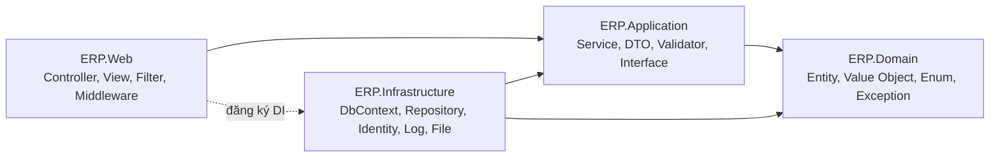

# Kiến trúc hệ thống

- **Trạng thái:** Đề xuất (bước 2a, phiên 2). Chưa triển khai. Giữ .NET 8.
- **Liên quan:** `docs/ANALYSIS.md` (mục 4, P0-09, P1-25), `docs/adr/ADR-004-identity-va-vai-tro.md`

---

## 1. Hiện trạng

Solution gồm 2 project: `ERP_HRM_CMS` (ứng dụng) và `ERP_HRM_CMS.Tests`. Mã nguồn được tổ chức theo loại (`Controllers/`, `Data/`, `Models/`, `Services/`, `Helpers/`), không theo tầng. Controller truy cập `AppDbContext` trực tiếp (337 chỗ), nên nghiệp vụ, truy vấn và giao diện bị gộp chung.

## 2. Kiến trúc mục tiêu

Áp dụng Clean Architecture với 4 project theo yêu cầu dự án:

```
ERP.Web  ──────────►  ERP.Application  ◄──────────  ERP.Infrastructure
   │                        │                              │
   │                        ▼                              │
   └──────────────►  ERP.Domain  ◄─────────────────────────┘
```

Quy tắc phụ thuộc: mũi tên chỉ về phía **trong**. `Domain` không phụ thuộc gì. `Application` chỉ phụ thuộc `Domain`. `Infrastructure` và `Web` phụ thuộc `Application` (và `Domain`). Chỉ `Web` đăng ký `Infrastructure` vào DI (composition root).



### 2.1 Trách nhiệm từng project

| Project | Chứa | Không được chứa |
|---|---|---|
| **ERP.Domain** | Entity, Value Object, Enum, Domain Exception, interface nghiệp vụ thuần (ví dụ `IPayrollCalculator`) | EF Core, ASP.NET, truy cập DB, I/O |
| **ERP.Application** | Use case/Service, DTO, FluentValidation validator, mapping, interface `IRepository<T>`, `IUnitOfWork`, `PagedResult<T>`, `Result<T>` | EF Core, `DbContext`, `HttpContext`, Razor |
| **ERP.Infrastructure** | `AppDbContext`, Repository và UnitOfWork cài đặt, cấu hình Identity, gửi email, lưu file, Serilog sink, Health Check, migration | Logic nghiệp vụ, ViewModel |
| **ERP.Web** | Controller (mỏng: nhận request, gọi Application, trả View/JSON), View, ViewModel, Filter, Middleware, `wwwroot` | Truy vấn trực tiếp `DbContext`, quy tắc nghiệp vụ |

### 2.2 Quy tắc cho controller

- Controller không gọi `AppDbContext`. Mọi thao tác dữ liệu đi qua service của tầng `Application`.
- Controller không chứa quy tắc nghiệp vụ (ví dụ giới hạn giảm giá, kiểm tra tồn kho).
- Validation: FluentValidation ở `Application` cho server-side, data annotation và jQuery Validate cho client.

## 3. Cấu hình dùng chung

| Thành phần | Vị trí | Ghi chú |
|---|---|---|
| DI theo tầng | `AddApplication()` (Application), `AddInfrastructure()` (Infrastructure), `AddWebServices()` (Web) | Mỗi tầng tự đăng ký dịch vụ của mình qua extension method |
| Xử lý lỗi tập trung | Middleware ở `ERP.Web` | Trả trang lỗi thân thiện. Production không lộ stack trace. Development hiển thị chi tiết |
| Logging | Serilog ở `ERP.Web` (cấu hình), sink file và console | Log có cấu trúc, có mã tương quan (correlation id) |
| Health Check | `/health` ở `ERP.Web` | Kiểm tra kết nối DB |
| Audit base | Lớp cơ sở cho entity: `CreatedAt`, `CreatedBy`, `UpdatedAt`, `UpdatedBy`, `IsDeleted` | Gán tự động trong `SaveChanges` (đã có cơ chế audit log, mở rộng thêm) |
| Phân trang | `PagedResult<T>` ở `Application` | Dùng cho mọi danh sách |
| Kết quả thao tác | `Result<T>` ở `Application` | Thay cho việc ném exception để báo lỗi nghiệp vụ |

## 4. Module và vị trí trong tầng

Mỗi module nghiệp vụ được tổ chức theo cùng một khuôn: entity ở `Domain`, use case và DTO ở `Application`, repository ở `Infrastructure`, controller ở `Web`.

| Module | Domain | Application | Infrastructure | Web |
|---|---|---|---|---|
| Identity và phân quyền | `Role`, `Permission` | `IAuthService`, `IUserService`, `IPermissionService` | Identity, `PasswordHasher` tùy chỉnh | `AuthController`, `QuanTriTaiKhoanController`, `PhanQuyenController` |
| HRM | `Employee`, `Department`, `Contract`, `LeaveRequest`, `SalarySlip` | `IEmployeeService`, `IPayrollService` | Repository | `NhanSuController`, `ChamCongController`, `DonTuController`, `BangLuongController` |
| CMS | `Content`, `Menu`, `Banner`, `SiteLayout` | `IContentService`, `IMenuService` | Repository, lưu file | `ContentController`, `MenuController`, `PublicController` |
| Kho và bán hàng | `Product`, `Inventory`, `Order`, `PurchaseOrder`, `Supplier` | `IInventoryService`, `IPosService`, `IOrderService` | Repository, `InventoryStockService` | `KhoController`, `BanHangController`, `DonHangController`, `PurchaseOrderController` |
| Thông báo | `Notification` | `INotificationService` | SignalR, Repository | `NotificationController`, `Hubs/` |

Thứ tự chuyển đổi: làm từng module một theo kiểu strangler. Module mới làm theo kiến trúc mục tiêu ngay. Module cũ giữ nguyên cho tới khi được chuyển.

## 5. Luồng xử lý một request (ví dụ tạo đơn POS)

1. `BanHangController.XuatDonPOS` (Web) nhận `POSCheckoutDto`, kiểm tra định dạng bằng data annotation.
2. Controller gọi `IPosService.CheckoutAsync` (Application).
3. `PosService` kiểm tra quy tắc nghiệp vụ: giới hạn giảm giá, tồn kho, tiền khách đưa. Dùng `IUnitOfWork` để lấy dữ liệu và lưu thay đổi trong một transaction.
4. Repository (Infrastructure) thực thi truy vấn EF Core. Trừ tồn qua `InventoryStockService`.
5. `Result<OrderDto>` trả về Web. Controller chuyển thành View hoặc JSON.

## 6. Quy ước đặt tên

- Class, method, biến, route, tên file code: tiếng Anh (ví dụ `OrderService`, `CheckoutAsync`, route `/order/checkout`).
- Comment và thông báo người dùng: tiếng Việt.
- Route tiếng Việt hiện có (`/NhanSu`, `/BanHang`...) giữ nguyên trong giai đoạn chuyển đổi. Đổi dần theo module, có redirect từ route cũ.

## 7. Nợ kỹ thuật cần xử lý trong quá trình chuyển đổi

Chi tiết trong `docs/ANALYSIS.md`. Các mục liên quan trực tiếp đến kiến trúc:
- Controller gọi DbContext trực tiếp (337 chỗ), nghiệp vụ nằm trong controller (S4, S5, S6 của phân tích).
- Identity lấy từ Session và rơi về user id `1` (S5).
- Phạm vi dữ liệu theo chi nhánh chưa có (S4). Thiết kế này sẽ nằm ở `Application` (filter theo phạm vi trong service), không ở controller.
