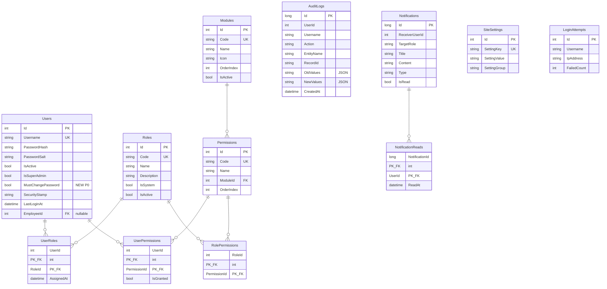
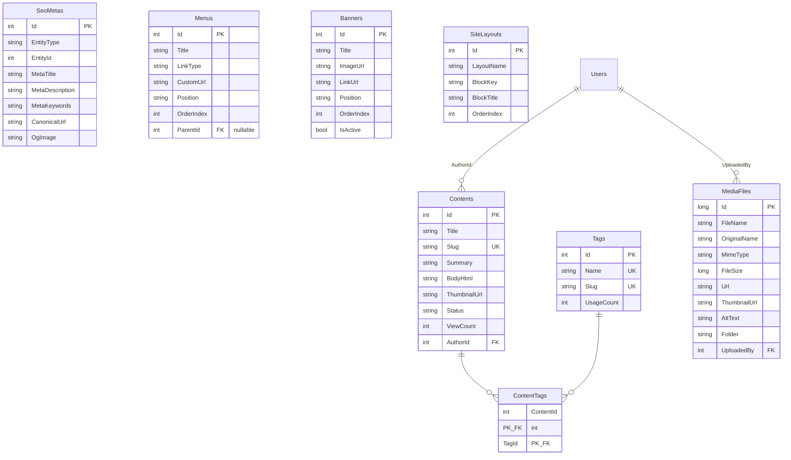

# ERD — Sơ đồ quan hệ thực thể

> Cập nhật: Phiên 2 (2026-11-05) — Enterprise HRM, Clean Architecture & Bảo mật
> Quy ước: int PK (Identity) cho bảng thường, long PK cho bảng dữ liệu lớn.
> Tất cả bảng nghiệp vụ có: CreatedAt, UpdatedAt, IsDeleted, CreatedBy, UpdatedBy.

---

## 1. Nhóm Hệ thống (System)



---

## 2. Nhóm HRM (Nhân sự Enterprise Khép Kín)

```mermaid
erDiagram
    Companies {
        int Id PK
        string Code UK
        string Name
        string TaxCode
        string Phone
        bool IsActive
    }
    Branches {
        int Id PK
        string Code UK
        string Name
        int CompanyId FK
        bool IsActive
    }
    Departments {
        int Id PK
        string Code UK
        string Name
        int BranchId FK
        int ParentId FK "nullable, self-ref"
        bool IsActive
    }
    Positions {
        int Id PK
        string Code UK
        string Name
        decimal BaseSalary "18,2"
        decimal AllowanceRate "5,2"
        bool IsActive
    }
    Employees {
        int Id PK
        string EmployeeCode UK
        string FullName
        datetime DateOfBirth
        string Gender
        string Email UK
        string Phone
        string IdentityCard "encrypted"
        string Status
        datetime HireDate
        bool IsDeleted
        int DepartmentId FK
        int PositionId FK
    }
    EmployeeDetails {
        int EmployeeId PK_FK
        string BankAccountNumber "encrypted"
        string BankName
        string TaxIdentificationNumber
        string SocialInsuranceNumber
        string EducationLevel
    }
    Contracts {
        int Id PK
        string ContractNumber UK
        string ContractType
        datetime StartDate
        datetime EndDate
        decimal BasicSalary "18,2"
        string Status
        int EmployeeId FK
    }
    Shifts {
        int Id PK
        string Code UK
        string Name
        time StartTime
        time EndTime
        decimal WorkHours "4,2"
    }
    AttendanceDailies {
        long Id PK
        datetime WorkDate
        time FirstInTime
        time LastOutTime
        int LateMinutes
        decimal WorkHourCount "4,2"
        decimal OvertimeHours "4,2"
        string AttendanceStatus
        int EmployeeId FK
        int ShiftId FK
    }
    AttendanceLocks {
        int Id PK
        int Month
        int Year
        int BranchId FK "nullable"
        int DepartmentId FK "nullable"
        bool IsLocked
        datetime LockedAt
        int LockedById FK
    }
    AttendanceAdjustmentRequests {
        int Id PK
        string RequestCode UK
        int EmployeeId FK
        datetime WorkDate
        int ShiftId FK "nullable"
        string AdjustmentType
        time ActualInTime
        time ActualOutTime
        string Reason
        string Status
        int ApprovedById FK
    }
    LeaveTypes {
        int Id PK
        string Code UK
        string Name
        int MaxDaysPerYear
        bool IsPaid
        bool IsActive
    }
    LeaveRequests {
        int Id PK
        string RequestCode UK
        int LeaveTypeId FK
        datetime FromDate
        datetime ToDate
        decimal TotalDays "5,2"
        string Reason
        string Status
        int EmployeeId FK
        int CreatedByUserId FK "NEW P0"
    }
    EmployeeLeaveBalances {
        int Id PK
        int EmployeeId FK
        int Year
        int LeaveTypeId FK
        decimal StandardDays "5,2"
        decimal SeniorityBonusDays "5,2"
        decimal CarriedOverDays "5,2"
        decimal UsedDays "5,2"
        decimal RemainingDays "5,2"
        datetime ExpiredCarryOverDate
    }
    PayrollPeriods {
        int Id PK
        string Name
        int Month
        int Year
        int StandardWorkDays
        string Status
        decimal TotalGross "18,2"
        decimal TotalNet "18,2"
    }
    SalarySlips {
        int Id PK
        decimal BasicSalary "18,2"
        decimal ActualWorkDays "5,2"
        decimal NetSalary "18,2"
        string Status
        int PayrollPeriodId FK
        int EmployeeId FK
    }
    HrDecisions {
        int Id PK
        string DecisionNumber UK
        int EmployeeId FK
        string DecisionType
        string Title
        datetime EffectiveDate
        int OldDepartmentId FK "nullable"
        int NewDepartmentId FK "nullable"
        int OldPositionId FK "nullable"
        int NewPositionId FK "nullable"
        decimal OldSalary "18,2"
        decimal NewSalary "18,2"
        decimal Amount "18,2"
        string Status
        int ApprovedById FK
    }
    CompanyAssets {
        int Id PK
        string AssetCode UK
        string AssetName
        string AssetType
        string SerialNumber
        decimal PurchasePrice "18,2"
        string Status
        int BranchId FK
    }
    EmployeeAssetAssignments {
        int Id PK
        int AssetId FK
        int EmployeeId FK
        datetime AssignedDate
        string ConditionOnAssign
        datetime ReturnedDate "nullable"
        string ConditionOnReturn "nullable"
        string Status
        int AssignedById FK
    }
    OnboardingChecklists {
        int Id PK
        int EmployeeId FK
        string Type
        string Title
        datetime StartDate
        datetime TargetCompletionDate
        string Status
        int AssignedHrId FK
    }
    OnboardingTasks {
        int Id PK
        int ChecklistId FK
        string TaskName
        string DepartmentRole
        int AssignedToUserId FK
        datetime DueDate
        bool IsCompleted
        string Status
        int OrderIndex
    }
    JobPostings {
        int Id PK
        string Code UK
        string Title
        string Slug UK "NEW SEO"
        int DepartmentId FK
        int PositionId FK
        int Vacancies
        string Description
        string Requirements
        string Status
        datetime OpenDate
        datetime CloseDate
    }
    Candidates {
        int Id PK
        string Code UK
        string FullName
        string Email
        string Phone
        string ResumeUrl
        string Status
        int JobPostingId FK
    }
    InterviewSchedules {
        int Id PK
        int CandidateId FK
        int RoundNumber
        string Title
        datetime ScheduledTime
        int DurationMinutes
        string InterviewType
        string LocationOrMeetingLink
        int InterviewerEmployeeId FK
        string Status
        decimal Score "5,2"
        string Result
    }
    Trainings {
        int Id PK
        string Code UK
        string Title
        string TrainerName
        string Location
        datetime StartDate
        datetime EndDate
        decimal Budget "18,2"
        string Status
    }
    TrainingParticipants {
        int TrainingId PK_FK
        int EmployeeId PK_FK
        string Result
        decimal Score "5,2"
    }
    KpiReviews {
        int Id PK
        int EmployeeId FK
        int ReviewerId FK
        int PeriodMonth
        int PeriodYear
        decimal TotalScore "5,2"
        string Grade
        string Status
    }
    KpiCriteria {
        int Id PK
        int KpiReviewId FK
        string CriteriaName
        decimal Weight "5,2"
        decimal Score "5,2"
        string Comment
    }

    Companies ||--o{ Branches : ""
    Branches ||--o{ Departments : ""
    Departments ||--o{ Employees : ""
    Positions ||--o{ Employees : ""
    Employees ||--|| EmployeeDetails : ""
    Employees ||--o{ Contracts : ""
    Employees ||--o{ AttendanceDailies : ""
    Employees ||--o{ LeaveRequests : ""
    Employees ||--o{ SalarySlips : ""
    Employees ||--o{ EmployeeLeaveBalances : ""
    LeaveTypes ||--o{ EmployeeLeaveBalances : ""
    Employees ||--o{ AttendanceAdjustmentRequests : ""
    Shifts ||--o{ AttendanceAdjustmentRequests : ""
    Employees ||--o{ HrDecisions : ""
    Employees ||--o{ EmployeeAssetAssignments : ""
    CompanyAssets ||--o{ EmployeeAssetAssignments : ""
    Branches ||--o{ CompanyAssets : ""
    Employees ||--o{ OnboardingChecklists : ""
    OnboardingChecklists ||--o{ OnboardingTasks : ""
    Candidates ||--o{ InterviewSchedules : ""
    LeaveTypes ||--o{ LeaveRequests : ""
    PayrollPeriods ||--o{ SalarySlips : ""
    Shifts ||--o{ AttendanceDailies : ""
    Departments ||--o{ JobPostings : ""
    Positions ||--o{ JobPostings : ""
    JobPostings ||--o{ Candidates : ""
    Trainings ||--o{ TrainingParticipants : ""
    Employees ||--o{ TrainingParticipants : ""
    KpiReviews ||--o{ KpiCriteria : ""
```

---

## 3. Nhóm CMS (Nội dung)



---

## 4. Nhóm Kho & Bán hàng (SCM)

```mermaid
erDiagram
    Categories {
        int Id PK
        string Code UK
        string Name
        string Slug UK
        int ParentId FK "nullable"
        int OrderIndex
        bool IsActive
    }
    Units {
        int Id PK
        string Code UK
        string Name
        bool IsActive
    }
    Products {
        int Id PK
        string SKU UK
        string Barcode
        string Name
        string Slug UK
        decimal CostPrice "18,2"
        decimal SalePrice "18,2"
        string ImageUrl
        bool IsActive
        int CategoryId FK
        int UnitId FK
    }
    Customers {
        int Id PK
        string Code UK
        string FullName
        string Phone UK
        string Email
        string Address
        string TaxCode
        decimal TotalDebt "18,2"
        bool IsActive
    }
    Warehouses {
        int Id PK
        string Code UK
        string Name
        string Address
        int BranchId FK
        bool IsActive
    }
    Inventories {
        int Id PK
        int ProductId FK
        int WarehouseId FK
        int StockQuantity
        int MinStockAlert
        int MaxStockLimit
    }
    InventoryTransactions {
        long Id PK
        string TransactionCode UK
        string TransactionType "IN/OUT/TRANSFER"
        int Quantity
        decimal UnitPrice "18,2"
        int SourceWarehouseId FK "nullable"
        int DestWarehouseId FK "nullable"
        int ProductId FK
        int CreatedBy FK
    }
    Suppliers {
        int Id PK
        string Code UK
        string Name
        string TaxCode
        string Phone
        decimal TotalDebt "18,2"
        bool IsActive
    }
    PurchaseOrders {
        long Id PK
        string POCode UK
        decimal TotalAmount "18,2"
        decimal PaidAmount "18,2"
        decimal DebtAmount "18,2"
        string Status
        int SupplierId FK
        int BranchId FK
    }
    PurchaseOrderDetails {
        long Id PK
        int Quantity
        decimal UnitPrice "18,2"
        long PurchaseOrderId FK
        int ProductId FK
    }
    Orders {
        long Id PK
        string OrderCode UK
        decimal TotalAmount "18,2"
        decimal DiscountAmount "18,2"
        decimal FinalAmount "18,2"
        string OrderStatus
        string PaymentStatus
        string PaymentMethod
        int CustomerId FK "nullable"
        int BranchId FK
        int CreatedBy FK
    }
    OrderDetails {
        long Id PK
        int Quantity
        decimal UnitPrice "18,2"
        long OrderId FK
        int ProductId FK
    }
    Invoices {
        long Id PK
        string InvoiceCode UK
        string InvoiceType "SALES/PURCHASE"
        decimal TotalAmount "18,2"
        decimal TaxAmount "18,2"
        decimal GrandTotal "18,2"
        datetime InvoiceDate
        long OrderId FK "nullable"
        long PurchaseOrderId FK "nullable"
        int CustomerId FK "nullable"
        int SupplierId FK "nullable"
    }
    Payments {
        long Id PK
        string PaymentCode UK
        decimal Amount "18,2"
        string PaymentMethod
        datetime PaymentDate
        string ReferenceType "ORDER/INVOICE/DEBT"
        long ReferenceId
        int CreatedBy FK
    }
    DebtRecords {
        long Id PK
        string DebtType "RECEIVABLE/PAYABLE"
        string PartnerType
        decimal TotalAmount "18,2"
        decimal PaidAmount "18,2"
        decimal RemainingAmount "18,2"
        string Status
        int SupplierId FK "nullable"
        int CustomerId FK "nullable"
    }
    DebtPayments {
        long Id PK
        string PaymentCode UK
        decimal Amount "18,2"
        string PaymentMethod
        long DebtRecordId FK
    }
    StocktakingSheets {
        long Id PK
        string Code UK
        datetime CheckDate
        string Status
        int WarehouseId FK
    }
    StocktakingDetails {
        long Id PK
        int SystemQuantity
        int ActualQuantity
        int DifferenceQuantity
        decimal DifferenceValue "18,2"
        long StocktakingSheetId FK
        int ProductId FK
    }

    Categories ||--o{ Products : ""
    Units ||--o{ Products : ""
    Products ||--o{ Inventories : ""
    Products ||--o{ OrderDetails : ""
    Products ||--o{ PurchaseOrderDetails : ""
    Warehouses ||--o{ Inventories : ""
    Branches ||--o{ Warehouses : ""
    Customers ||--o{ Orders : ""
    Orders ||--o{ OrderDetails : ""
    Orders ||--o{ Invoices : ""
    Suppliers ||--o{ PurchaseOrders : ""
    PurchaseOrders ||--o{ PurchaseOrderDetails : ""
    PurchaseOrders ||--o{ Invoices : ""
    DebtRecords ||--o{ DebtPayments : ""
    StocktakingSheets ||--o{ StocktakingDetails : ""
```



---

## 5. Tổng hợp số lượng bảng hệ thống (67 Bảng)

| Nhóm | Số bảng | Mô tả |
|---|---|---|
| Hệ thống | 12 | Auth, Quyền, Modules, AuditLog, Notifications, LoginAttempt, Settings |
| HRM Core & Profile | 15 | Company, Branch, Department, Position, Employee, Details, Contract, Shift, Attendance, 5 bảng Profile mở rộng, SeedHistory |
| HRM Quỹ phép & Tiền lương | 7 | LeaveType, LeaveRequest, EmployeeLeaveBalance, AttendanceLock, AttendanceAdjustmentRequest, PayrollPeriod, SalarySlip, Dependents |
| HRM Tuyển dụng, Đào tạo, KPI, Quyết định, Onboarding | 9 | JobPosting, Candidate, InterviewSchedule, Training, TrainingParticipant, KpiReview, KpiCriteria, HrDecision, OnboardingChecklist, OnboardingTask |
| HRM Quản lý Tài sản | 2 | CompanyAsset, EmployeeAssetAssignment |
| CMS | 7 | Content, Category, Menu, Banner, Tag, ContentTag, MediaFile, SeoMeta |
| Kho & Bán hàng (SCM) | 16 | Product, Inventory, InventoryTransaction, Order, OrderDetail, CartItem, Supplier, PO, PODetail, DebtRecord, DebtPayment, StocktakingSheet, Detail, Customer, Unit, Warehouse, Invoice, Payment |
| **Tổng cộng** | **67 Bảng** | **Toàn bộ thực thể đã được mô hình hóa và đồng bộ 100% trên SSMS và EF Core** |
